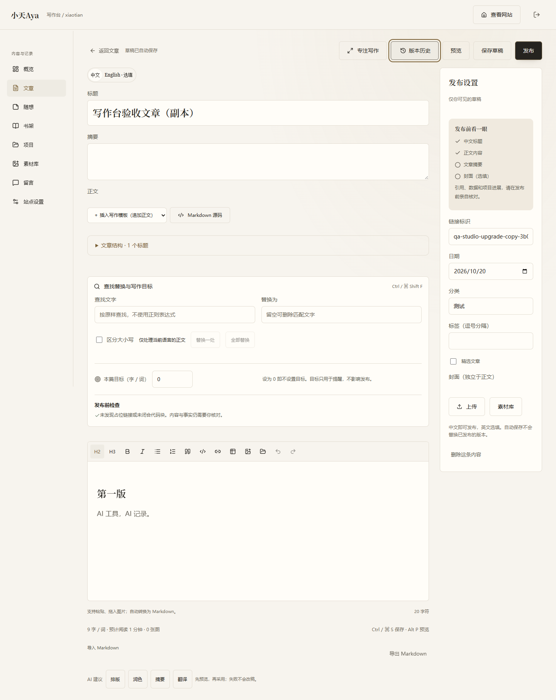
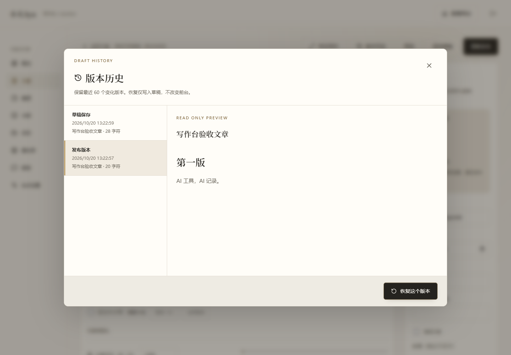

# 写作台增强版 · v1.1.0

## 新增功能

### 版本历史

编辑页顶部的“版本历史”会先保存当前草稿，再打开历史列表。选择一个版本可以查看正文；确认恢复后，只更新草稿，前台仍显示原来的公开版本。需要对外更新时，再点击“更新发布”。

文章、随想、书籍和项目都会记录最近 60 个有变化的版本。重复保存相同内容不会增加版本；删除内容也会删除其历史。升级前没有的历史无法补回，首次保存时会保留当时的版本。

恢复前会再保存一次当前草稿，因此选错版本也可以回到恢复前。书籍封面、项目图集等字段随版本一起保存，图片文件仍需保留在上传目录中。

### 查找替换与写作目标

在正文上方展开“查找替换与写作目标”，或按 Ctrl / ⌘ Shift F。支持按原文查找、区分大小写、替换一处或全部替换。替换操作可以撤销；如果之后又写了新内容，撤销按钮会停用，避免覆盖后续写作。

可以为当前内容设置字数目标。设为 0 即关闭提醒，目标不限制发布。发布前检查会提示空网址、未完成标记、正文一级标题和未闭合代码块，不会替你判断内容是否真实。

### 复制和内容备份

内容列表提供“复制成草稿”。副本使用新链接，原来的内容和发布状态不变；不会自动发布。

概览页的“导出内容备份”会下载 JSON，包含四类内容的公开版本、修改草稿和站点文字设置。不包含留言、密码、会话、模型密钥或图片二进制文件。该文件仅用于内容留存，当前不提供一键导入。

完整运维备份仍需要单独保存 `server/data/` 和 `public/uploads/`，勿将它们提交到公开仓库。

## 验证

```powershell
pnpm test
pnpm lint
pnpm build
pnpm check:publication
node scripts/run-garden-check.mjs scripts/garden-studio-upgrade-check.js --studio
```

版本测试覆盖去重、60 版上限、数据库重开、内容归属校验、恢复草稿与公开版本隔离，以及删除与事务失败。浏览器检查覆盖查找替换、撤销、目标保存、恢复、复制、下载与 360–1920px 六种宽度。

浏览器验收只使用独立隐藏窗口，不覆盖用户预览的原生窗口尺寸。验收文章与副本在检查后清理。

## 公开发布范围

发布仓库：[MarcusDog/personweb](https://github.com/MarcusDog/personweb)。此次包含此前的奶油暖金博客重构、真实书封和本次写作台增强。

- 公开：前后端源码、站点展示素材、测试、操作说明。
- 不公开：SQLite 数据库、上传目录中的用户素材、私信、账号凭据、环境密钥、本机浏览器状态和备份导出。
- 清理了素材清单及准备脚本中的本机绝对路径；保留素材归属、类型、原图与图注。
- `check:publication` 检查公开文件及保留的 Git 历史中的常见密钥模式，不输出匹配到的值。它不是完整的专业安全审计。

将代码推送到 GitHub 不等于部署生产服务器。部署前设置管理员强密码、HTTPS、站点域名与持久化目录，见 [部署和维护](garden-implementation.md)。

## 界面




